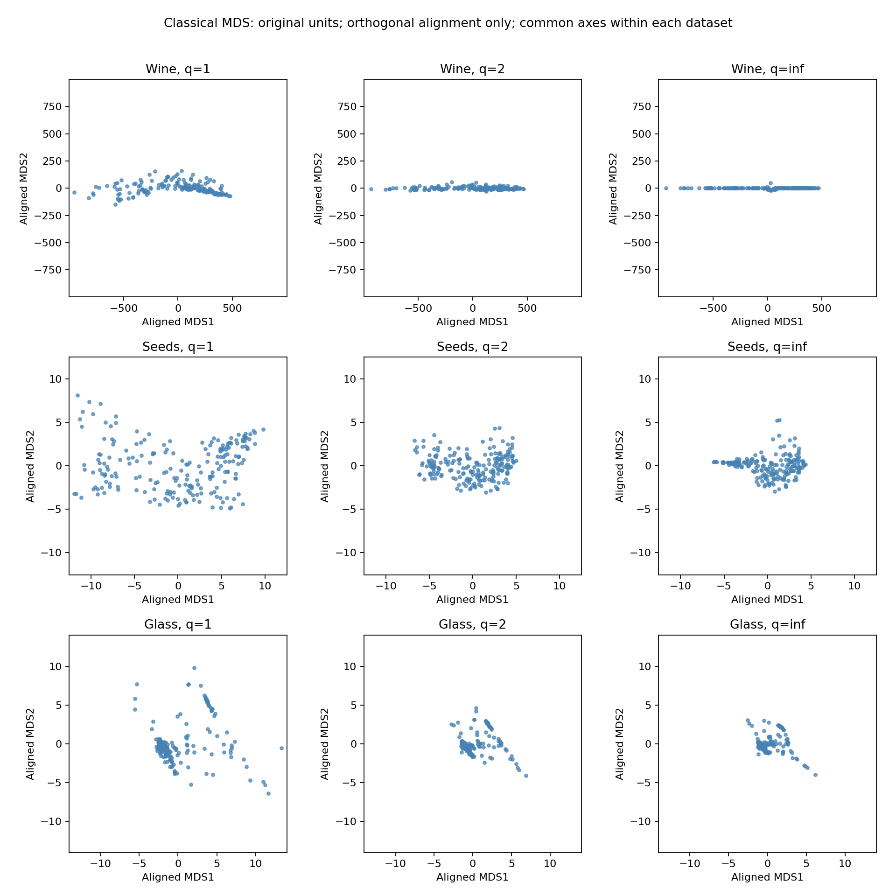

# Minkowski geometry: Wine, Seeds and Glass Identification

## Selection and reproducibility

Exactly these three UCI datasets were locked before any q-dependent computation; see [selection record](../data/stage4/selection.md) and [source/cleaning audit](../data/acquisition.json). No replacements or dataset-specific q additions were made. Wine is 178×13, Seeds 210×7, Glass Identification 214×9. All use numeric unsupervised features in original units and source row order, with targets/IDs excluded. No missing rows, imputations or scaling. Duplicate observations are retained (one in Glass; none in Wine or Seeds). A largest 214×214 double matrix is 0.35 MiB, so explicit distances and dense eigendecomposition are feasible.

| Dataset | UCI ID / official page | Exact archive member | Selection rationale |
|---|---|---|---|
| Wine | [109](https://archive.ics.uci.edu/dataset/109/wine) | wine.data | 13 chemical measures with heterogeneous magnitudes |
| Seeds | [236](https://archive.ics.uci.edu/dataset/236/seeds) | seeds_dataset.txt | Seven geometric features including derived compactness |
| Glass Identification | [42](https://archive.ics.uci.edu/dataset/42/glass+identification) | glass.data | Oxide composition, zeros and refractive index |

Commands: `python code/investigate.py` reruns both dimensions via the exact mds.py CLI for every dataset/q and rebuilds this report. Full spectra, embedding coordinates and PNGs are retained under results/stage4/. Metrics and per-observation neighborhoods are also retained. Source archives and pages are included; no live retrieval is needed to replay submitted matrices.

## Definitions and numerical policy

We compute D_q from original feature differences (never from PCA coordinates). Classical MDS uses G = −½ J(D_q squared elementwise)J, symmetrizes G and uses scipy.linalg.eigh. The top K eigenvectors are multiplied by square roots of their eigenvalues, clipping negative values to zero, as in the handout. Small positive values are retained in coordinates; diagnostics classify eigenvalues using τ = 100 n ε max|λ| (with the smallest positive float as a zero-spectrum floor). A meaningful negative is λ < −τ. This threshold scales with the spectrum and conservatively accounts for roundoff, not scientific uncertainty.

Negative mass = Σ(−λ) over meaningful negatives. Negative fraction = negative mass/(negative mass + meaningful positive mass), which allows scale-normalized comparisons across q. Positive spectral fractions sum the leading two/three meaningful positive eigenvalues divided by total meaningful positive mass. These fractions do not measure original-distance fit when negative spectrum exists. Distance error is ||D_embedding − D_q||_F / ||D_q||_F; embedding distances are Euclidean. Classical MDS minimizes Gram/STRAIN approximation, not this distance error, so monotone improvement in distance error is not guaranteed by its objective.

Neighborhoods contain the five nearest observations, including every tie within 10^-12 max(1, fifth-distance) of the boundary; self is excluded. Agreement is set Jaccard relative to q=2, averaged over rows. Duplicate observations remain valid neighbors. Spearman uses upper-triangle pairwise distances and average ranks for ties. Stable/unstable row summaries average Jaccard over the five non-q=2 settings and use one-based final-matrix row indices; every tied extremum is listed.

## Full numerical comparison

| Dataset | q | Negative count | Negative mass | Negative fraction | Positive 2D | Positive 3D | Error 2D | Error 3D | Neighbor Jaccard | Distance rank ρ |
|---|---:|---:|---:|---:|---:|---:|---:|---:|---:|---:|
| wine | 1 | 111 | 947655 | 0.04435 | 0.94329 | 0.95596 | 0.02956 | 0.02981 | 0.78495 | 0.99858 |
| wine | 1.5 | 114 | 98506.1 | 0.00549 | 0.99329 | 0.99498 | 0.00635 | 0.00716 | 0.92055 | 0.99992 |
| wine | 2 | 0 | -0 | -0.00000 | 0.99983 | 0.99992 | 0.00096 | 0.00046 | 1.00000 | 1.00000 |
| wine | 3 | 68 | 25584.9 | 0.00145 | 0.99866 | 0.99889 | 0.00365 | 0.00337 | 0.95506 | 0.99997 |
| wine | 4 | 72 | 27672.3 | 0.00157 | 0.99860 | 0.99881 | 0.00463 | 0.00414 | 0.94195 | 0.99996 |
| wine | inf | 72 | 28227.9 | 0.00160 | 0.99858 | 0.99881 | 0.00556 | 0.00498 | 0.87118 | 0.99991 |
| seeds | 1 | 131 | 1863.49 | 0.14624 | 0.85030 | 0.88841 | 0.08420 | 0.08156 | 0.72891 | 0.98866 |
| seeds | 1.5 | 138 | 284.068 | 0.06528 | 0.93149 | 0.95173 | 0.03848 | 0.03242 | 0.86939 | 0.99817 |
| seeds | 2 | 0 | -0 | -0.00000 | 0.99302 | 0.99868 | 0.01101 | 0.00222 | 1.00000 | 1.00000 |
| seeds | 3 | 84 | 146.809 | 0.05942 | 0.93133 | 0.95949 | 0.04408 | 0.03174 | 0.89099 | 0.99789 |
| seeds | 4 | 100 | 208.985 | 0.08494 | 0.90629 | 0.94349 | 0.06512 | 0.04824 | 0.82772 | 0.99545 |
| seeds | inf | 122 | 376.398 | 0.13947 | 0.84836 | 0.89044 | 0.09804 | 0.07947 | 0.73328 | 0.98891 |
| glass | 1 | 139 | 1481.71 | 0.17963 | 0.54917 | 0.66451 | 0.27420 | 0.17056 | 0.73971 | 0.99000 |
| glass | 1.5 | 145 | 175.283 | 0.07439 | 0.65945 | 0.77412 | 0.26070 | 0.16467 | 0.88640 | 0.99861 |
| glass | 2 | 0 | -0 | -0.00000 | 0.73940 | 0.84720 | 0.25242 | 0.17391 | 1.00000 | 1.00000 |
| glass | 3 | 73 | 78.513 | 0.06880 | 0.71890 | 0.80897 | 0.24624 | 0.12451 | 0.87161 | 0.99803 |
| glass | 4 | 88 | 114.337 | 0.10294 | 0.70871 | 0.79429 | 0.24663 | 0.12489 | 0.81247 | 0.99497 |
| glass | inf | 103 | 235.205 | 0.18777 | 0.65535 | 0.73508 | 0.25464 | 0.12964 | 0.66628 | 0.98295 |

## Independent centered-PCA validation at q=2

For each unchanged X, scipy.linalg.svd(X−mean(X), full_matrices=False) yields PCA coordinates. Orthogonal Procrustes aligns the MDS coordinates without translation or scaling; both are already centered. Relative coordinate and pairwise-distance Frobenius discrepancies are below. No PCA routine is used inside mds.py.

| Dataset | Dimensions | Aligned coordinate error | Pairwise-distance error |
|---|---:|---:|---:|
| wine | 2 | 1.715e-15 | 1.319e-15 |
| wine | 3 | 7.411e-15 | 1.416e-15 |
| seeds | 2 | 2.162e-15 | 5.365e-16 |
| seeds | 3 | 2.357e-15 | 5.713e-16 |
| glass | 2 | 2.357e-15 | 1.800e-15 |
| glass | 3 | 3.671e-15 | 1.689e-15 |

At q=2, double-centering squared Euclidean distances gives G = X_centered X_centered^T. Its eigenvectors and eigenvalues give the same truncated configuration as centered PCA, up to orthogonal transformations. Reflections and rotations are allowed, but rescaling is not. With eigenvalue ties at a truncation boundary, equivalent choices of subspace may need additional care; the selected numerical comparisons pass.

## Wine: measured behavior

The largest normalized negative mass occurs at q=1 (0.04435); the largest absolute negative mass occurs at q=1 (947655). These are distinct definitions of 'farthest from PSD': the normalized value controls for overall spectral scale, while absolute mass does not. Negative eigenvalues establish that the full dissimilarity geometry is not exactly Euclidean; clipping necessarily discards part of it.

The lowest mean neighborhood agreement is at q=1 (0.78495); its pairwise-distance rank correlation is 0.99858. Compare both measures: overall distance order and local neighborhoods need not change equally. Across non-q=2 values, most-stable rows are [1, 4, 5, 6, 9, 11, 15, 19, 22, 24, 31, 32, 36, 37, 38, 49, 61, 65, 66, 71, 72, 81, 88, 94, 104, 124, 125, 126, 140, 145, 146, 147, 148, 149, 158, 160, 162, 164, 169, 174, 176, 177] (mean Jaccard 1.00000); least-stable rows are [136] (0.58571). These refer to observations, not class labels; detailed per-q scores are in `wine_neighborhood_stability.csv`.

| Feature | SD | Range | Share of squared pairwise differences | Zero fraction |
|---|---:|---:|---:|---:|
| proline | 314.022 | 1402 | 0.99774 | 0.00000 |
| magnesium | 14.2423 | 92 | 0.00205 | 0.00000 |
| alcalinity_of_ash | 3.33017 | 19.4 | 0.00011 | 0.00000 |
| color_intensity | 2.31176 | 11.72 | 0.00005 | 0.00000 |
| malic_acid | 1.114 | 5.06 | 0.00001 | 0.00000 |
| flavanoids | 0.996049 | 4.74 | 0.00001 | 0.00000 |
| alcohol | 0.809543 | 3.8 | 0.00001 | 0.00000 |
| od280_od315 | 0.707993 | 2.73 | 0.00001 | 0.00000 |
| total_phenols | 0.624091 | 2.9 | 0.00000 | 0.00000 |
| proanthocyanins | 0.570749 | 3.17 | 0.00000 | 0.00000 |
| ash | 0.273572 | 1.87 | 0.00000 | 0.00000 |
| hue | 0.227929 | 1.23 | 0.00000 | 0.00000 |
| nonflavanoid_phenols | 0.124103 | 0.53 | 0.00000 | 0.00000 |

The largest q=2 contribution is proline (99.77% of total squared pairwise differences). This contribution uses differences/variances, not raw means: a feature can have a large mean and little influence on distances.

## Seeds: measured behavior

The largest normalized negative mass occurs at q=1 (0.14624); the largest absolute negative mass occurs at q=1 (1863.49). These are distinct definitions of 'farthest from PSD': the normalized value controls for overall spectral scale, while absolute mass does not. Negative eigenvalues establish that the full dissimilarity geometry is not exactly Euclidean; clipping necessarily discards part of it.

The lowest mean neighborhood agreement is at q=1 (0.72891); its pairwise-distance rank correlation is 0.98866. Compare both measures: overall distance order and local neighborhoods need not change equally. Across non-q=2 values, most-stable rows are [1, 6, 8, 24, 35, 56, 71, 74, 77, 89, 90, 108, 115, 121, 133, 140, 155, 160, 169, 174, 201, 202] (mean Jaccard 1.00000); least-stable rows are [181] (0.41667). These refer to observations, not class labels; detailed per-q scores are in `seeds_neighborhood_stability.csv`.

| Feature | SD | Range | Share of squared pairwise differences | Zero fraction |
|---|---:|---:|---:|---:|
| area | 2.90276 | 10.59 | 0.65057 | 0.00000 |
| asymmetry_coefficient | 1.49997 | 7.6909 | 0.17372 | 0.00000 |
| perimeter | 1.30285 | 4.84 | 0.13106 | 0.00000 |
| groove_length | 0.490309 | 2.031 | 0.01856 | 0.00000 |
| kernel_length | 0.442007 | 1.776 | 0.01508 | 0.00000 |
| kernel_width | 0.376814 | 1.403 | 0.01096 | 0.00000 |
| compactness | 0.0235731 | 0.1102 | 0.00004 | 0.00000 |

The largest q=2 contribution is area (65.06% of total squared pairwise differences). This contribution uses differences/variances, not raw means: a feature can have a large mean and little influence on distances.

## Glass: measured behavior

The largest normalized negative mass occurs at q=inf (0.18777); the largest absolute negative mass occurs at q=1 (1481.71). These are distinct definitions of 'farthest from PSD': the normalized value controls for overall spectral scale, while absolute mass does not. Negative eigenvalues establish that the full dissimilarity geometry is not exactly Euclidean; clipping necessarily discards part of it.

The lowest mean neighborhood agreement is at q=inf (0.66628); its pairwise-distance rank correlation is 0.98295. Compare both measures: overall distance order and local neighborhoods need not change equally. Across non-q=2 values, most-stable rows are [49, 59, 65, 67, 68, 69, 108, 117, 159, 177, 192, 193, 194, 196, 197, 201, 204, 205, 206, 207, 211, 212, 214] (mean Jaccard 1.00000); least-stable rows are [181] (0.37698). These refer to observations, not class labels; detailed per-q scores are in `glass_neighborhood_stability.csv`.

| Feature | SD | Range | Share of squared pairwise differences | Zero fraction |
|---|---:|---:|---:|---:|
| magnesium | 1.43903 | 4.49 | 0.33003 | 0.19626 |
| calcium | 1.41982 | 10.76 | 0.32128 | 0.00000 |
| sodium | 0.814693 | 6.65 | 0.10578 | 0.00000 |
| silicon | 0.772734 | 5.6 | 0.09516 | 0.00000 |
| potassium | 0.650666 | 6.21 | 0.06747 | 0.14019 |
| aluminum | 0.498102 | 3.21 | 0.03954 | 0.00000 |
| barium | 0.496056 | 3.15 | 0.03922 | 0.82243 |
| iron | 0.0972108 | 0.51 | 0.00151 | 0.67290 |
| refractive_index | 0.00302976 | 0.02278 | 0.00000 | 0.00000 |

The largest q=2 contribution is magnesium (33.00% of total squared pairwise differences). This contribution uses differences/variances, not raw means: a feature can have a large mean and little influence on distances.

## Units, interpretation and cross-dataset conclusions

Wine measures different chemical quantities. The archived official description lists their names but does not specify all physical units. In the supplied numerical encoding, Proline dominates squared differences; this makes near-one-dimensional distance structure plausible. This is a property of raw numeric units, not evidence that Proline is intrinsically the most important chemical feature. A change of its units could materially change all q results.

Seeds mixes area, perimeter/length measurements, asymmetry and derived dimensionless compactness. UCI does not state the physical length/area units on the inspected page, so none are invented here. Area has the largest numerical variation; correlated size features can reinforce one another at low q. The experiment is reproducible in the supplied encoding, but combining these quantities without scaling has no unit-invariant physical interpretation. Compactness C=4πA/P² establishes redundancy independently of our numerical results.

Glass combines a dimensionless refractive index with eight oxide weight percentages. The chemical components share a reported unit, making their relative magnitudes more directly interpretable than in Wine/Seeds, but refractive index has a very different scale. Compositional constraints also induce dependence. Zero oxide values are documented numeric measurements, not missing-value markers. Calcium and Magnesium variation should be assessed from the feature table rather than the much larger mean Silicon concentration.

The tables establish which effects are shared: every q=2 spectrum has no meaningful negative eigenvalues, and every q=2 PCA comparison agrees to floating-point precision. For these selected matrices, moving away from q=2 introduces negative spectrum and changes at least some local neighborhoods. Neither the magnitude of non-Euclidean distortion nor the ordering of its worst q is a theorem that applies to every dataset. Compare normalized negative mass, retained positive mass and distance errors separately; no single diagnostic captures them all.

Mathematically, for a fixed difference vector, ||v||_1 ≥ ||v||_1.5 ≥ ||v||_2 ≥ ||v||_3 ≥ ||v||_4 ≥ ||v||_∞. This does not preserve the ranking of different pairs. Large q emphasizes the largest coordinate difference in each pair; small q accumulates contributions across coordinates. These facts suggest mechanisms for observed neighborhood changes, but do not prove causal explanations of dataset-specific patterns. q=2 guarantees a PSD centered Gram matrix for Euclidean feature distances; other q values need not produce negative eigenvalues on every finite configuration.

## Visual evidence and limits

Raw CLI plots for all q and both dimensions are retained under stage4/ as reproducible outputs. They share point style, panel size, equal-axis convention and row order, and identify dataset/q. MDS axes can rotate or reflect independently across q; visual orientation is not itself a geometry change. The numerical tables and rotation-invariant checks are the primary evidence. No class labels were used. Supporting comparison panels, if included, are discussed separately below.

These conclusions concern exactly three preselected datasets in their original units. They do not establish universal best q values, label separation, or robustness to feature rescaling. Neighborhood changes measured above are in input-distance geometry, not an assertion that every change is visually apparent in 2D. Low-dimensional plots omit positive spectral mass and discard negative spectrum; apparent overlap can therefore be projection error.

## Supporting panels and checked interpretations

These panels were inspected after the numerical experiment. Each row uses identical numeric limits and equal axis scales; q=1, 2 and infinity configurations are orthogonally aligned to q=2 without rescaling. Their differing extents therefore include the expected contraction of Minkowski norms as q increases, in addition to changes in shape. The images alone cannot separate these effects.

- **Wine:** The q=1 cloud is visibly thicker transverse to its long axis; q=2 and infinity appear nearly linear at this common scale. At q=2, the first two positive directions capture 99.983% of positive mass, compared with 94.329% at q=1. Proline contributes approximately 99% of squared pairwise differences (exact share in the feature table), explaining why large-scale order is robust in this raw encoding: even q=1 has distance-rank correlation 0.99858 with q=2. Local agreement is less robust (0.78495 at q=1). Thus the apparently similar global ordering does not imply identical neighborhoods. Increasing to 3D at q=1 slightly worsens normalized distance error (0.02956 to 0.02981); this is consistent with optimizing STRAIN rather than distance stress.
- **Seeds:** The q=1 panel has a broad curved configuration; infinity produces a more compact, differently shaped cloud with a visible narrow leftward extension. The q=2 panel lies between them in extent. Do not interpret these shapes as recovered wheat varieties. Neighborhood agreement is approximately 0.729 at q=1 and 0.733 at infinity, while pairwise-rank correlations remain about 0.989. Positive mass captured in 2D drops from 0.99302 at q=2 to 0.85030 and 0.84836 at those endpoints. The endpoints are comparably sensitive locally even though q=1 has the larger negative fraction (0.14624 versus 0.13947). A useful explanation is that area, perimeter and length measurements jointly contribute at low q, whereas the largest single difference controls infinity; correlations make this a mechanism to consider, not a proved causal attribution.
- **Glass:** A dense central cloud and several separated arms/outlying observations persist visually, but their relative locations change. The q=1 panel spreads more widely than q=2 or infinity; part of this is expected norm contraction. Its 2D positive-mass fraction is only 0.54917 at q=1 and 0.73940 at q=2. At infinity, the local agreement is 0.66628, lower than Wine or Seeds at infinity, and rank correlation is 0.98295. This supports a stronger local-geometry change despite superficial persistence of some arms. Glass is farthest from PSD by normalized negative mass at infinity (0.18777), whereas its absolute negative mass is greatest at q=1. Calcium and Magnesium are the largest variance contributors; Silicon's large mean does not make it dominant in pairwise differences.

The shared endpoint norm contraction is mathematical. The relatively stronger neighborhood changes in Glass at infinity, the near-linearity of Wine, and the particular Seeds shapes are empirical findings. All three have q=2 as their largest two-dimensional positive-mass fraction on this grid, but that observation does not establish a universal rule for arbitrary datasets/q. More positive mass in two dimensions does not guarantee smaller normalized distance error across different q: Glass has 3D error 0.17391 at q=2 versus 0.12451 at q=3, even though q=2 is PSD. The target distance matrix itself changes with q.
